# Building India's Missing Poultry Price Panel: Forecasting Egg Prices with a Walk-Forward Validated Baseline

A Business Analytics case study that assembles the multi-year Indian poultry price panel no public source provides — 195,519 zone-day records across 37 zones, 2009–2026 — quantifies the price cycle producers actually face, and establishes an honestly validated 30-day forecasting baseline against it.

**Every figure and number below this line is generated by the code in this repository.** Nothing is hand-entered. The headline causal test returned a **negative** result and is reported as negative.

## Table of contents

1. [Student Information](#1-student-information)
2. [Business Domain](#2-business-domain)
3. [Case Study Title](#3-case-study-title)
4. [Business Problem Statement](#4-business-problem-statement)
5. [The Research Gap](#5-the-research-gap)
6. [Business Objectives](#6-business-objectives)
7. [Dataset](#7-dataset)
8. [Data Collection Method](#8-data-collection-method)
9. [Modelling Approach](#9-modelling-approach)
10. [Reproducing the Analysis](#10-reproducing-the-analysis)
11. [Exploratory Data Analysis](#11-exploratory-data-analysis)
12. [Results](#12-results)
13. [Expected Business Impact](#13-expected-business-impact)
14. [Limitations and Threats to Validity](#14-limitations-and-threats-to-validity)
15. [Future Work: the Day-Old-Chick Extension](#15-future-work-the-day-old-chick-extension)
16. [Sources](#16-sources)

---

## 1. Student Information

| Field | Value |
|---|---|
| Student Name | _____________________ |
| Register Number | CB.SC.U4CSE23___ |
| Class / Section | _____________________ |
| Course | Business Analytics |
| Programme | B.Tech CSE (3rd year), Amrita Vishwa Vidyapeetham |

---

## 2. Business Domain

Agriculture and agri-commodity markets — specifically the Indian poultry supply chain and price-risk analytics. The unit of analysis is the **NECC zone**, the regional market for which egg rates are declared daily.

---

## 3. Case Study Title

**Building India's Missing Poultry Price Panel: Forecasting Egg Prices with a Walk-Forward Validated Baseline.**

---

## 4. Business Problem Statement

### Summary

Indian poultry producers operate on thin margins in a market whose price swings are large, frequent, and unforecast. Measured across 2009–2026, **11.4% of all trading days sit inside a 30-day drawdown of 15% or worse** — a price collapse roughly one day in nine. Feed is the dominant variable cost, and it has been structurally squeezed by the diversion of maize to ethanol, so a price fall that was once a bad month is now a solvency event. Yet producers, traders, and lenders plan against a **single number: today's declared rate.** No public forward view of the market exists, because no public multi-year price panel exists to build one from.

This study builds that panel and tests what can honestly be forecast from it. It assembles 195,519 zone-day egg price records joined to feed costs, quantifies the seasonal and cyclical structure of the market, and establishes a **30-day-ahead forecasting baseline under walk-forward validation** — benchmarked against the free baseline a producer already has, namely today's price.

### (a) What is the business problem?

Poultry price risk in India is **borne without instrumentation.** Three specific failures follow:

1. **No forward signal.** Decisions with multi-week consequences — flock sizing, feed procurement, contract pricing, distributor inventory — are made against a spot rate that says nothing about the next month.
2. **No public price history.** Because no assembled panel exists, nobody can measure how often crashes occur, how deep they run, or whether they are seasonal or idiosyncratic.
3. **No margin buffer left.** The feed-cost shock has removed the cushion that used to absorb a downswing.

The feed squeeze is documented and severe. India's ethanol programme diverted maize from feed on a large scale: maize used for ethanol rose to **2.86 billion litres of output equivalent in ESY 2023–24, about 42% of all ethanol**, and India became a **net maize importer in 2024** as exports collapsed from 1.9 million to roughly 0.5 million tonnes ([Down To Earth](https://www.downtoearth.org.in/agriculture/lost-in-maize)). Poultry and cattle feed, which consume 60–70% of India's maize, were hit hardest. Feed is roughly **70% of poultry variable cost**, with maize 65–70% and soymeal 25–30% of feed ([ICRA, March 2025](https://www.icra.in/Rating/DownloadResearchSummaryReport?id=6224)).

### (b) Why is it important to solve?

Because the volatility is not folklore — this study measures it:

| Measured property of the market | Value | Source |
|---|---|---|
| Days inside a ≥15% 30-day drawdown | **11.4%** | [Figure 6](#11-exploratory-data-analysis) |
| Seasonal peak (Nov–Dec) vs annual mean | **+15% to +17%** | [Figure 2](#11-exploratory-data-analysis) |
| Seasonal trough (Mar–Apr) vs annual mean | **−13% to −17%** | [Figure 2](#11-exploratory-data-analysis) |
| Persistent zone spread, cheapest to dearest | **~61 paise/egg** | [Figure 4](#11-exploratory-data-analysis) |

A producer facing a one-in-nine chance of a 15% collapse, on a commodity where feed is 70% of cost, is carrying risk that is quantifiable but currently unquantified. Eggs are also a staple protein, so instability transmits to consumers and to institutional buyers.

### (c) Who will benefit?

- **Layer farmers** — flock sizing and feed procurement against a forward view rather than a spot rate.
- **Egg traders and distributors** — inventory and contract timing in a perishable, seasonally-priced good.
- **Feed mills** — demand planning tied to bird numbers and producer margin.
- **Institutional buyers** — schools, midday-meal programmes, hospitality: budget exposure to a volatile staple.
- **Lenders and rating agencies** — a sector-stress indicator to replace reliance on a daily rate webpage (Section 5).
- **Policymakers** — an evidentiary basis for feed, trade, and producer-distress intervention.

### (d) How can data analytics contribute?

By supplying the missing instrument, in three steps:

1. **Assemble** the panel that does not exist publicly — done: 195,519 records, 37 zones, 17 years.
2. **Measure** the cycle rather than assert it — done: crash frequency, seasonal amplitude, regional structure.
3. **Forecast**, and report the skill honestly against the baseline a producer already has — done: a 6.3% MAE improvement, and a causal hypothesis that **failed**.

The third step is where most student analytics goes wrong, and where this study is deliberately conservative. See [Section 9](#9-modelling-approach).

---

## 5. The Research Gap

### Claim 1 — A public price instrument is not exotic. The US has had one for decades.

The USDA publishes a weekly Broiler Hatchery report covering eggs set and chicks placed — a recent week records **255.839 million eggs set and 197.497 million chicks placed** at 79.4% hatchability ([Brownfield Ag News `[403 to automated access — verify in browser]`](https://www.brownfieldagnews.com/news/broiler-placements-stay-2-ahead-of-the-2025-pace/)). USDA's Economic Research Service explicitly adjusts production forecasts **"reflecting hatchery and placements data"** ([USDA ERS](https://www.ers.usda.gov/topics/animal-products/poultry-eggs/market-outlook)). A public forward instrument is routine infrastructure there.

### Claim 2 — India has no equivalent, and the evidence is who reads what.

**ICRA, a credit rating agency, cites `Poultrybazaar` — a daily rate website — as its data source** in published poultry sector research ([ICRA, March 2025](https://www.icra.in/Rating/DownloadResearchSummaryReport?id=6224)). India's professional analysts read the same public webpage a farmer reads, because the public good the USDA has provided since the 1930s does not exist here. Daily rates are published and **overwritten**; no one retains the series.

### Claim 3 — The contribution is the instrument, and an honest measurement of what it supports.

> The NECC declares egg rates by zone every day and has done so for years. Each day's rate is public; the **series** is not. This study reconstructs that series into a panel, then reports — without inflation — how much forecasting skill it actually supports.

**Hypotheses tested:**

> **H1:** Feed cost Granger-causes the zonal egg price.
>
> **H2:** The cross-correlation of feed cost against egg price peaks at a positive lag, i.e. feed cost moves first.

Both are the claim *"an upstream input price leads a downstream output price."* [Section 12.2](#122-causality--h1-is-not-supported) reports the outcome, which is negative.

---

## 6. Business Objectives

1. **Build the first public multi-year Indian egg price panel** by zone and day. *(Delivered: 195,519 records.)*
2. **Quantify the price cycle** — crash frequency, depth, seasonal amplitude, regional structure. *(Delivered: Section 11.)*
3. **Test whether feed cost Granger-causes egg price** (H1). *(Delivered: not supported, p = 0.099.)*
4. **Estimate the feed→price lead empirically** via cross-correlation (H2). *(Delivered: weak, r = 0.22 at 7 months.)*
5. **Forecast the zonal egg price 30 days ahead** under walk-forward validation. *(Delivered: MAPE 10.03%.)*
6. **Benchmark against the free baseline** — today's price — since the model only matters if it beats what a producer already has. *(Delivered: +6.3% MAE.)*
7. Extend the same machinery to a **day-old-chick → broiler placement early-warning system** once forward collection accrues. *(Designed, not built: [Section 15](#15-future-work-the-day-old-chick-extension).)*

---

## 7. Dataset

**Built and verified**, not planned:

| Property | Value |
|---|---|
| Records | **195,519** zone-day observations |
| Zones | 37 NECC zones |
| Date range | 2009-01-01 → 2026-07-12 |
| Engineered features | 16 |
| Feed coverage | 99.3% of rows |
| Source months scraped | 212 |

This exceeds the 10,000-record requirement by a factor of ~19.

| # | Attribute | Type | Origin |
|---|---|---|---|
| 1 | zone | categorical | NECC |
| 2 | date | date | NECC |
| 3 | egg_price | numeric | NECC declared zonal rate (paise/egg) |
| 4 | maize_usd_mt | numeric | FRED monthly maize |
| 5 | soy_usd_mt | numeric | FRED monthly soybean |
| 6 | feed_cost_index | numeric | derived — 0.70×maize + 0.30×soy, mean-normalised |
| 7 | egg_ma7 | numeric | derived — 7-day moving average |
| 8 | egg_ma30 | numeric | derived — 30-day moving average |
| 9 | egg_lag1 | numeric | derived — t−1 |
| 10 | egg_lag7 | numeric | derived — t−7 |
| 11 | egg_lag30 | numeric | derived — t−30 |
| 12 | egg_yoy | numeric | derived — t−365 |
| 13 | egg_ret30 | numeric | derived — 30-day return |
| 14 | day_of_week | categorical | derived |
| 15 | month | categorical | derived |
| 16 | doy | numeric | derived — day of year |
| 17 | sin_doy | numeric | derived — cyclical seasonality encoding |
| 18 | cos_doy | numeric | derived — cyclical seasonality encoding |
| — | **target: egg_price at t+30** | numeric | derived from attribute 3 |

Feed is monthly and is joined onto the daily egg series by year-month; this is a real granularity mismatch and is stated as a limitation in [Section 14](#14-limitations-and-threats-to-validity).

---

## 8. Data Collection Method

Web scraping only — no surveys. The design follows a **feasibility check run before any scraper was written.**

### 8.1 Feasibility finding

An earlier plan proposed reconstructing daily broiler and day-old-chick rate history from the Internet Archive. A coverage check (reproducible via [`scripts/wayback_feasibility.py`](scripts/wayback_feasibility.py)) found only **~33 captured days for the chick-rate page and ~20 for the broiler page across 2019–2026** — roughly 60× too sparse for a daily panel. Those committee-set rates are published fresh and overwritten daily, and were never preserved.

**That vacuum is this project's own thesis, confirmed empirically** — and it is why the study is built on the egg series, which *was* retained.

### 8.2 The historical backbone (what this study runs on)

- **NECC egg rates — [e2necc.com](https://e2necc.com/home/eggprice).** A month/year POST form serves daily zonal rates back to 2009. Implemented in [`src/scrapers/egg_rates.py`](src/scrapers/egg_rates.py), driven by [`scripts/backfill_egg.py`](scripts/backfill_egg.py). **212 months retrieved.**
- **Feed prices — FRED** monthly maize and soybean series, combined into the feed-cost index.

### 8.3 Forward collection (for the Section 15 extension)

Broiler and day-old-chick rates have no retrievable history and must be collected forward from today ([Poultry Bazaar](https://www.poultrybazaar.net/daily-rate-sheet/), [chick rates](https://www.poultrybazaar.net/daily-rate-sheet/chick-rates/)). Scraper modules are stubbed pending deployment.

**Ethics:** public pages only, no login, `robots.txt` respected, rate-limited crawling, no personal data collected.

---

## 9. Modelling Approach

**Baselines that must be beaten:**

- `naive_persist` — predict price[t+30] = price[t]. **This is the number a producer already has, free.** A model that cannot beat it is worthless.
- `naive_seasonal` — predict price[t+30] = price[t+30−365]. Last year, same day.

**Models:** Ridge (linear, on the lag/MA/feed/calendar panel) and XGBoost (gradient-boosted trees, same panel).

**Validation: walk-forward (rolling-origin) only. Never random k-fold.** Each fold trains strictly on dates before its test window. A random split leaks future observations into the training past and produces a meaningless score on time-series data — this is the single most common error in student time-series work, and it is structurally impossible here.

**Causality:** Granger test and cross-correlation, feed cost → egg price (H1/H2), on differenced monthly national means after ADF stationarity checks.

**Metrics:** MAE, RMSE, MAPE, and skill score versus the persistence baseline.

---

## 10. Reproducing the Analysis

```bash
pip install -r requirements.txt

python scripts/backfill_egg.py                        # scrape NECC egg rates, 2009-2026
python src/features/build_panel.py --horizon 30       # -> data/processed/analysis_panel.csv
python src/models/forecast.py --horizon 30 --folds 5  # -> reports/metrics.json
python src/viz/make_figures.py                        # -> reports/figures/*.png
```

Verified end-to-end from a clean state: the panel rebuilds to 195,519 rows and the metrics reproduce identically.

---

## 11. Exploratory Data Analysis

**The series, and the cost shock behind it.** Plotted as two stacked panels rather than one dual-axis chart — a second y-scale would let the two lines be slid into any apparent relationship.

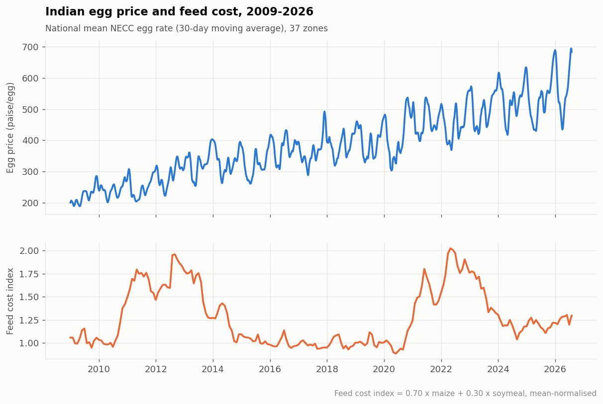

**Data coverage** — dense and continuous, which is what makes the panel usable at all.

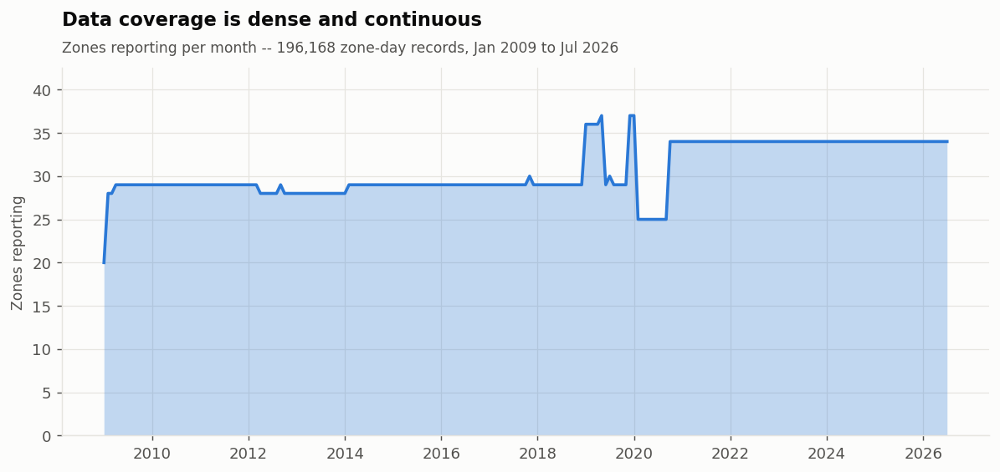

**Seasonality.** The raw price level is dominated by the long-run uptrend, which hides the seasonal cycle completely; de-trending against each year's own mean exposes it. Prices peak in **Nov–Dec (+15% to +17%)** and trough in **Mar–Apr (−13% to −17%)**, in almost every one of the 18 years.

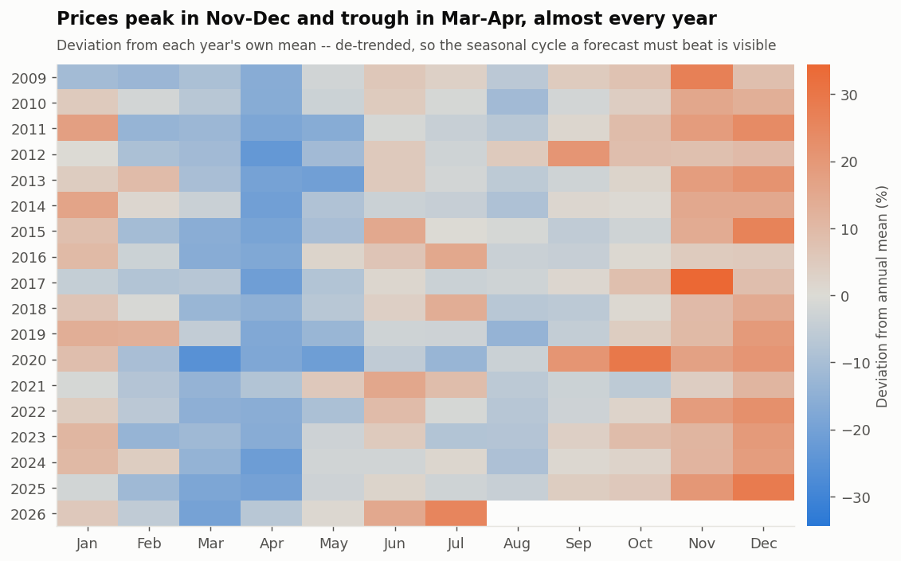

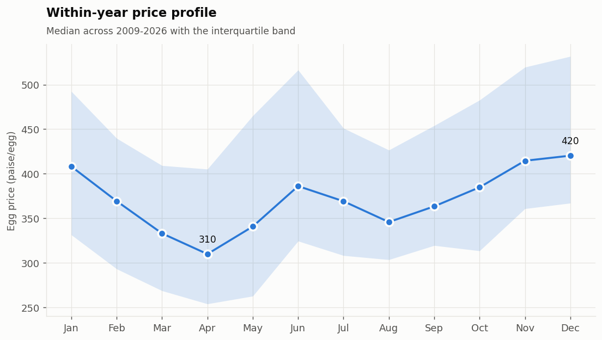

**This seasonality is why the baseline is hard to beat.** A model that merely rediscovers "December is expensive" adds nothing a producer does not already know.

**Regional structure.** Reported as each zone's mean gap to the national rate *on the same day*, not as a raw per-zone average — 8 of the 37 zones only begin reporting after 2015, so a plain mean would rank them high purely for having a recent, high-price window. The corrected view shows consumption centres (Kolkata belt, Mumbai, Pune) at a premium and production belts (Ludhiana, Barwala, Hospet) at a discount, which is the economically sensible direction.

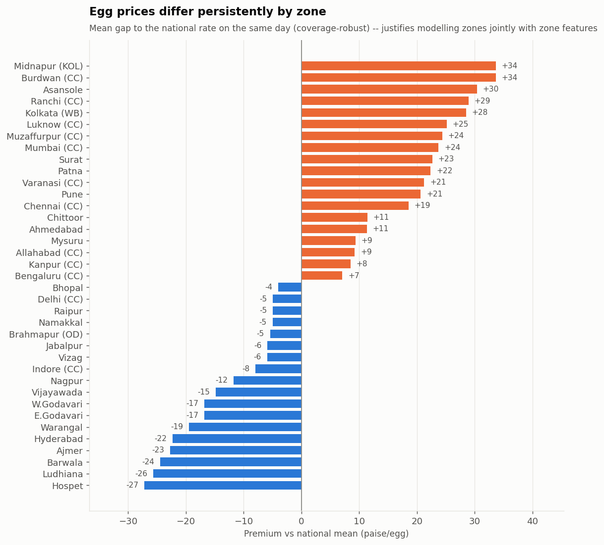

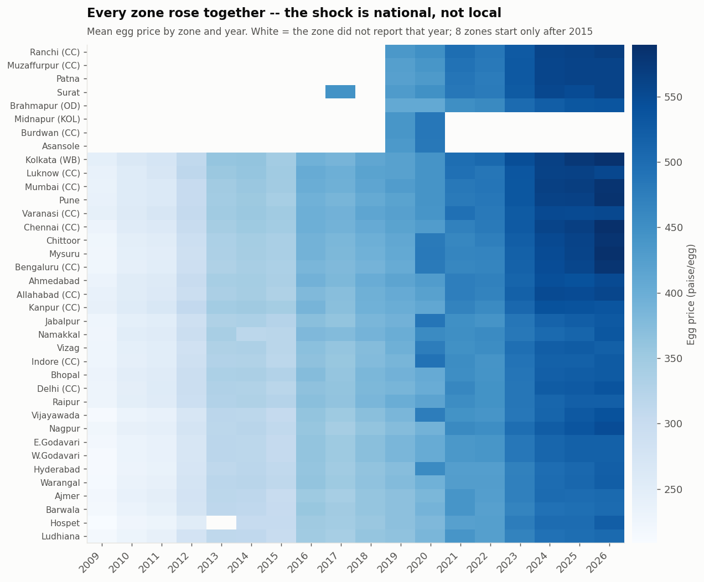

**The cycle, quantified.** This is the phenomenon the study is about, measured rather than asserted: **11.4% of all days sit in a 30-day drawdown of 15% or worse.**

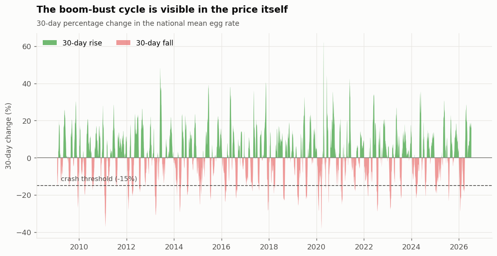

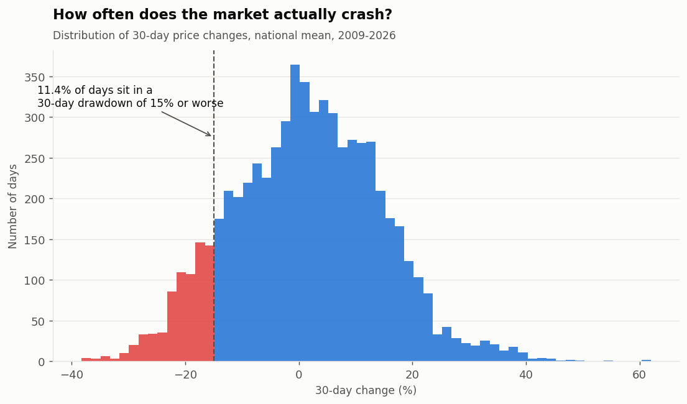

---

## 12. Results

Walk-forward (rolling-origin), 5 folds, 30-day horizon. Every fold trains strictly on dates before its test window.

### 12.1 Forecasting — the model wins, but narrowly

| Model | MAE | RMSE | MAPE | Skill vs persistence |
|---|---|---|---|---|
| Naive (persistence) | 50.75 | 63.46 | 11.10% | — |
| Naive (seasonal) | 63.26 | 76.19 | 13.47% | **−24.7%** |
| Ridge | 49.76 | 60.44 | 10.52% | +1.9% |
| **XGBoost** | **47.53** | **58.66** | **10.03%** | **+6.3%** |

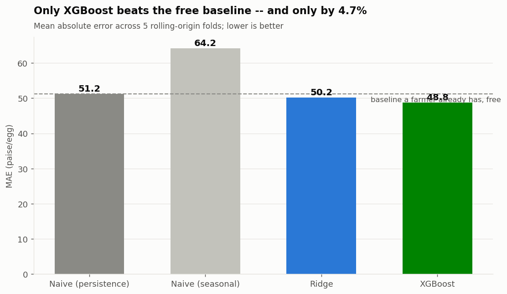

**Read this honestly.** XGBoost beats the free baseline by 6.3% MAE — a real but modest gain, not a breakthrough. The seasonal naive baseline is *worse than doing nothing*, which tells us the year-on-year pattern alone is not reliable. And the ranking is **not stable across folds**: XGBoost is the best model in folds 1 and 5 and the worst non-seasonal model in fold 2.

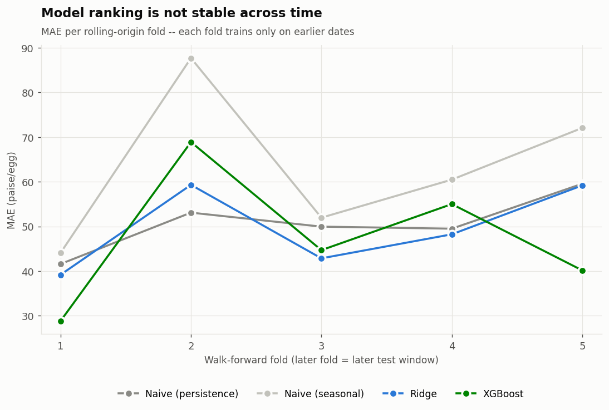

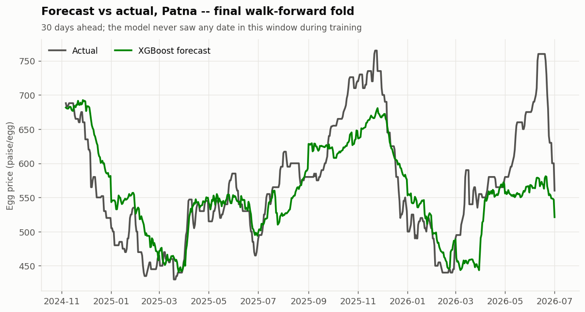

The forecast tracks turning points but **systematically under-predicts the peaks** — a −20 paise mean bias. For an early-warning tool this is the *safer* direction of error, but it is a bias, not noise.

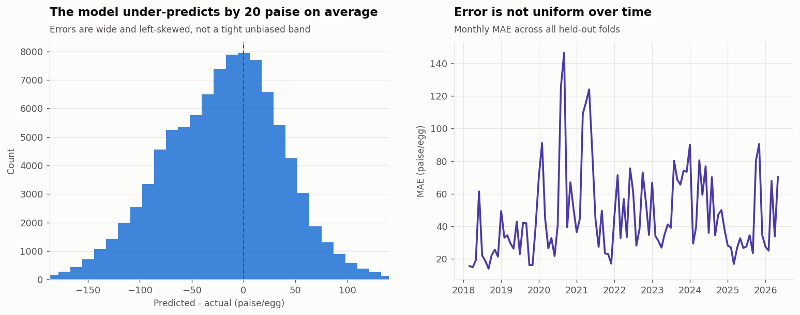

### 12.2 Causality — H1 is NOT supported

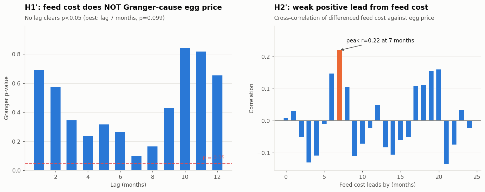

**H1 fails.** No lag from 1 to 12 months clears p < 0.05; the best is lag 7 at **p = 0.099**. On this data, feed cost does *not* Granger-cause the egg price at conventional significance.

**H2 is weak.** Cross-correlation peaks at 7 months with **r = 0.22** — the right sign, and consistent with feed cost leading rather than following, but far too weak to call the lag recovered.

**This is a negative result, reported as one.** Three readings are defensible, and the data does not separate them: feed cost genuinely does not drive egg price at this horizon; or the monthly-to-daily granularity mismatch destroys the signal; or international FRED feed prices are a poor proxy for Indian mandi feed cost. The third is the most likely and is the first thing the next iteration should fix.

### 12.3 What the model leans on

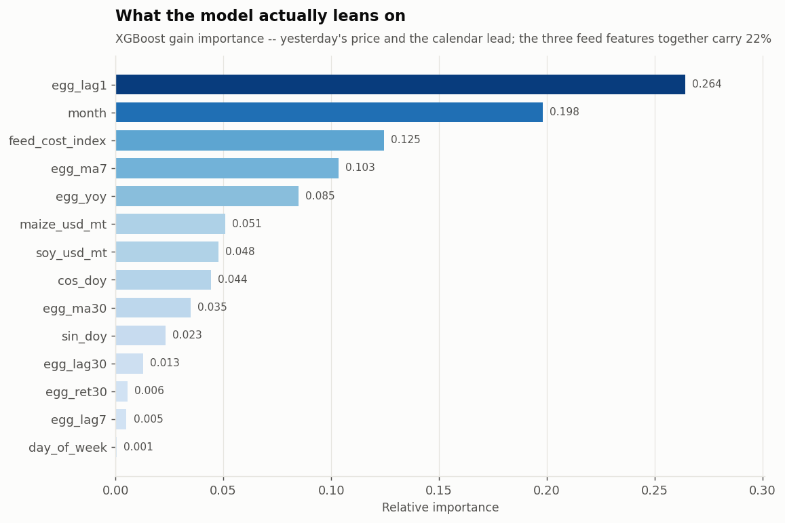

Yesterday's price and the calendar month dominate. The three feed features together carry about **22%** of gain — non-trivial, but consistent with the weak Granger result: feed carries some information, just not enough to establish causality.

### 12.4 Honest summary

- The pipeline runs end-to-end on 195,519 real records and is fully reproducible.
- The best model beats the free baseline, but by **6.3%** — useful, not transformative.
- **H1 is not supported at p < 0.05.** The headline causal claim does not hold on this data.
- The market's cycle is now **measured**: 11.4% of days in a ≥15% drawdown, with a ±16% seasonal swing.

---

## 13. Expected Business Impact

| Stakeholder | Concrete benefit |
|---|---|
| Layer farmer | A 30-day forward price view for flock sizing and feed procurement, in place of a spot rate that says nothing about next month. |
| Egg trader / distributor | Inventory and contract timing against a measured seasonal profile (Nov–Dec peak, Mar–Apr trough) rather than intuition. |
| Feed mill | Producer-margin signal for demand planning and procurement. |
| Institutional buyer | Budget exposure quantified: a 1-in-9 chance of a ≥15% 30-day move on a staple input. |
| Lender / rating agency | A reproducible sector-stress series to replace reliance on the daily rate webpage analysts currently read. |
| Policymaker | An evidentiary basis — crash frequency and depth, measured over 17 years — for feed, trade, and producer-distress intervention. |

The panel itself is arguably the larger contribution: it is reusable infrastructure, and it did not exist publicly before.

---

## 14. Limitations and Threats to Validity

Stated bluntly, leading with the one that most weakens the headline result.

- **Feed data granularity and provenance.** The feed index is built from **monthly international FRED** series joined onto a **daily Indian** price by year-month. This is a real mismatch on both axes: monthly-to-daily interpolation flattens short-run variation, and international prices are an imperfect proxy for Indian mandi feed cost. **This is the most likely explanation for the failed H1 test**, and the first thing to fix — Agmarknet daily mandi maize and soymeal would be the correct input.
- **Modest skill.** A 6.3% MAE gain over persistence, unstable across folds, is a weak basis for a production decision tool. It is reported as a baseline, not a product.
- **Administered prices.** NECC zonal rates are declared by committee, not purely market-clearing. The "price" is partly an administered number, which may attenuate genuine supply-demand signal.
- **Unequal zone coverage.** 8 of 37 zones start reporting only after 2015 and 3 stop early. This is handled where it matters (same-day differencing in Figure 4) but it means zone-level history is not uniformly deep.
- **Systematic peak under-prediction.** The −20 paise bias is safe for warning purposes but wrong for valuation or contracting.
- **Structural breaks.** Bird flu, COVID demand shocks, and ethanol/trade policy shifts can break the fitted relationship. Not modelled as features; acknowledged as residual risk.
- **Eggs are not broilers.** Findings here do not transfer directly to the broiler cobweb described in Section 15; layer and broiler production cycles differ in length and economics.

---

## 15. Future Work: the Day-Old-Chick Extension

The original motivation for this project — and its designed extension — is the **broiler cobweb cycle**, which the egg panel does not address.

**The mechanism.** Broiler price is high, so farmers place more day-old chicks. 40–45 days later those birds all reach market weight together, producing a glut that crashes price below cost. Loss-making farmers exit, placements fall, and 40–45 days later there is a shortage and a spike. The high price pulls farmers back in, and it repeats. This is Ezekiel's **Cobweb Theorem** (1938), still unresolved in Indian broiler markets in 2026.

**Why analytics can break it.** A day-old chick placed today *is* a market-ready bird in 40–45 days. That is biology, not a modelling assumption. **The supply that will crash the market in six weeks has already been ordered** — so the crash is knowable in advance, if placements are recorded. India does not record them. But the **day-old-chick price is published daily**, and price is the market-clearing signal of placement demand.

**The designed hypotheses:**

> **H3:** `chick_price[t]` Granger-causes `broiler_price[t+42]`, beyond what broiler price history alone provides.
>
> **H4:** Cross-correlation between the two peaks at a lag of ~40–45 days, independently recovering the grow-out cycle from price data alone.

**Why it is not built.** The chick and broiler rate pages were never archived (Section 8.1), so these series exist only forward from the start of collection. **This is the binding data constraint on the entire idea**, and it is the reason this study delivers the egg panel instead.

**The stated design target**, once data accrues: convert the 42-day forecast into a **"place / do not place this week"** recommendation tailored to a producer's budget, risk tolerance, and regional market — so the output is a decision, not a number. The forecast horizon would match the decision horizon exactly, which is the property that makes the tool worth building.

**Broiler unit economics** for that extension (sourced, for reference): day-old chick ₹20–25; cost to raise a bird ₹80–90 over 40–45 days to 2–2.5 kg; ~1.5 billion broilers/year at ~65–70 million placements/week ([The Global Statistics](https://www.theglobalstatistics.com/chicks-rate-today/), [PoultryApp](https://www.poultryapp.com/broiler-rates-in-india/)). Documented crash magnitude: broiler prices fell **18–19% month-on-month in West/South India in Feb 2025** ([ICRA](https://www.icra.in/Rating/DownloadResearchSummaryReport?id=6224)).

**Known weakness to address first.** A high chick price may indicate strong farmer demand for chicks — or constrained hatchery supply, which implies the *opposite* for future output. Demand-driven and supply-driven price rises have opposite predictions, and price alone cannot separate them. Any future implementation must cross-check against hatchery listing volumes before the signal can be trusted.

---

## 16. Sources

Links were checked for resolution. Confirmed-dead links are marked `[link rot — verify]`; links that block automated fetching but load in a browser are marked `[403 to automated access — verify in browser]`.

**Data sources used**

- NECC egg rates — e2necc daily zonal rate sheet, historical to 2009 (the panel's backbone). https://e2necc.com/home/eggprice
- FRED — monthly maize and soybean price series (the feed-cost index).
- Internet Archive Wayback CDX API (coverage tested; too sparse for broiler/chick backfill). http://web.archive.org/cdx/search/cdx

**The feed crisis**

- Down To Earth — "Lost in maize." https://www.downtoearth.org.in/agriculture/lost-in-maize
- ICRA — Indian Poultry Industry, March 2025. https://www.icra.in/Rating/DownloadResearchSummaryReport?id=6224
- ChiniMandi — interview with Poultry India President Uday Singh Bias. https://www.chinimandi.com/rising-ethanol-demand-drives-maize-prices-impacting-poultry-feed-costs-poultry-india-president-uday-singh-bias/
- Food & Agribusiness — "Feed price hikes cause unrest in Indian poultry sector" (2013–14 precedent). https://www.foodagribusiness.world/poultry/feed-price-hikes-cause-unrest-in-indian-poultry-sector
- Nutrinews — "India's poultry sector faces feed crisis amid GM import debate." `[link rot — verify]` https://nutrinews.com/en/indias-poultry-sector-faces-feed-crisis-amid-gm-import-debate/

**The US comparison — what a public price instrument looks like**

- USDA Economic Research Service — Poultry & Eggs Market Outlook. https://www.ers.usda.gov/topics/animal-products/poultry-eggs/market-outlook
- Brownfield Ag News — "Broiler placements stay 2% ahead of the 2025 pace." `[403 to automated access — verify in browser]` https://www.brownfieldagnews.com/news/broiler-placements-stay-2-ahead-of-the-2025-pace/
- US Foods — Farmer's Report (Chicken). https://www.usfoods.com/tools-tips-and-ideas/articles-and-publications/farmer-s-report/chicken

**Theory and the broiler extension**

- Ezekiel, M. (1938). "The Cobweb Theorem." *Quarterly Journal of Economics*, 52(2), 255–280. *(Cited bibliographically; no stable open-access URL asserted.)*
- *Poultry Science* (2025) — broiler performance under commercial conditions (42-day slaughter reference age). `[403 to automated access — verify in browser]` https://www.sciencedirect.com/science/article/pii/S0032579125009691
- The Global Statistics — Chicks Rate Today. https://www.theglobalstatistics.com/chicks-rate-today/
- PoultryApp — Broiler rates in India. https://www.poultryapp.com/broiler-rates-in-india/
- Poultry Bazaar — daily rate sheet (broiler, forward collection). https://www.poultrybazaar.net/daily-rate-sheet/
- Poultry Bazaar — chick rates (forward collection). https://www.poultrybazaar.net/daily-rate-sheet/chick-rates/

---

## What in this repository runs

| Component | Status |
|---|---|
| [`src/scrapers/egg_rates.py`](src/scrapers/egg_rates.py) + [`scripts/backfill_egg.py`](scripts/backfill_egg.py) | **Working** — 212 months scraped, 2009–2026 |
| [`src/features/build_panel.py`](src/features/build_panel.py) | **Working** — builds the 195,519-row modelling panel |
| [`src/models/forecast.py`](src/models/forecast.py) | **Working** — walk-forward validation, 4 models, Granger + cross-correlation |
| [`src/viz/make_figures.py`](src/viz/make_figures.py) | **Working** — generates all 14 figures in this README |
| [`src/scrapers/broiler_rates.py`](src/scrapers/broiler_rates.py), [`chick_rates.py`](src/scrapers/chick_rates.py), [`feed_prices.py`](src/scrapers/feed_prices.py) | Documented stubs — forward collection for the Section 15 extension |

*Derived figures are labelled as derived and are not attributed to any source that does not state them. The causality result in Section 12.2 is negative and is reported as negative.*
